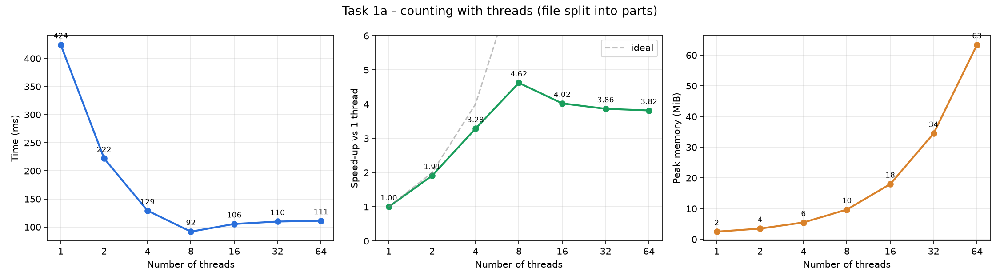
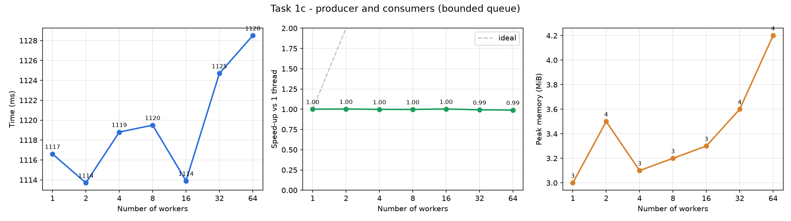
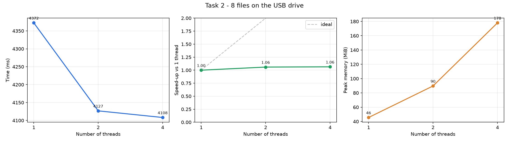
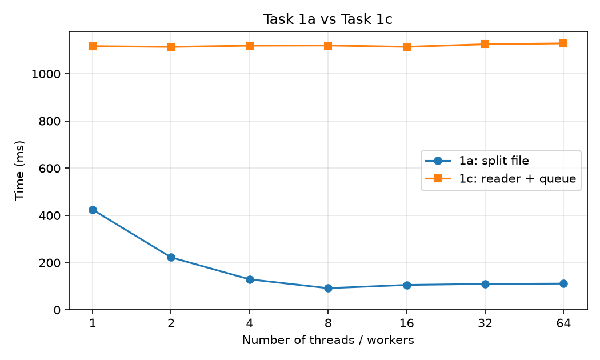
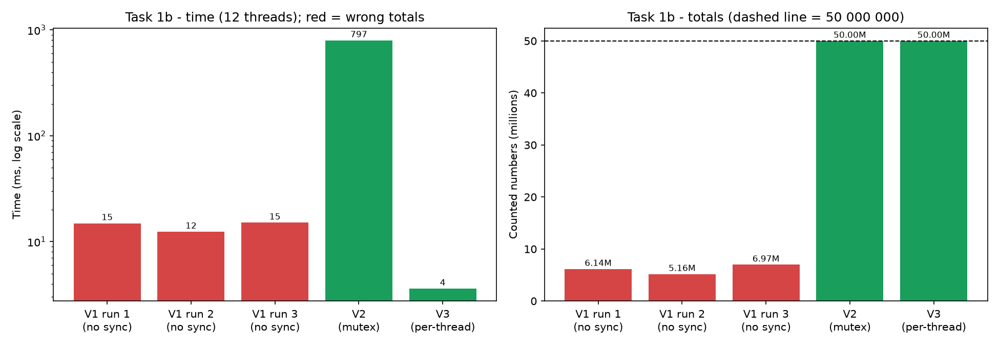

# Results tables (generated by run_all.py charts)

## Task 1a

| Threads | Time (ms) | Speed-up | Peak memory (MiB) | Totals |
|---:|---:|---:|---:|---|
| 1 | 424 | 1.00 | 2.5 | 24997972 / 25002011 / 17 = 50000000 ✔ |
| 2 | 222 | 1.91 | 3.5 | 24997972 / 25002011 / 17 = 50000000 ✔ |
| 4 | 129 | 3.28 | 5.5 | 24997972 / 25002011 / 17 = 50000000 ✔ |
| 8 | 92 | 4.62 | 9.7 | 24997972 / 25002011 / 17 = 50000000 ✔ |
| 16 | 106 | 4.02 | 18.0 | 24997972 / 25002011 / 17 = 50000000 ✔ |
| 32 | 110 | 3.86 | 34.5 | 24997972 / 25002011 / 17 = 50000000 ✔ |
| 64 | 111 | 3.82 | 63.4 | 24997972 / 25002011 / 17 = 50000000 ✔ |

## Task 1c

| Threads | Time (ms) | Speed-up | Peak memory (MiB) | Reader wait (ms) | Totals |
|---:|---:|---:|---:|---:|---|
| 1 | 1117 | 1.00 | 3.0 | 3 | 24997972 / 25002011 / 17 = 50000000 ✔ |
| 2 | 1114 | 1.00 | 3.5 | 3 | 24997972 / 25002011 / 17 = 50000000 ✔ |
| 4 | 1119 | 1.00 | 3.1 | 3 | 24997972 / 25002011 / 17 = 50000000 ✔ |
| 8 | 1120 | 1.00 | 3.2 | 3 | 24997972 / 25002011 / 17 = 50000000 ✔ |
| 16 | 1114 | 1.00 | 3.3 | 3 | 24997972 / 25002011 / 17 = 50000000 ✔ |
| 32 | 1125 | 0.99 | 3.6 | 3 | 24997972 / 25002011 / 17 = 50000000 ✔ |
| 64 | 1128 | 0.99 | 4.2 | 3 | 24997972 / 25002011 / 17 = 50000000 ✔ |

## Task 2

| Threads | Time (ms) | Speed-up | Peak memory (MiB) | Σ read (ms) | Σ parse (ms) | Totals |
|---:|---:|---:|---:|---:|---:|---|
| 1 | 4372 | 1.00 | 45.6 | 4112 | 260 | 24997972 / 25002011 / 17 = 50000000 ✔ |
| 2 | 4127 | 1.06 | 89.7 | 7542 | 260 | 24997972 / 25002011 / 17 = 50000000 ✔ |
| 4 | 4108 | 1.06 | 178.0 | 13473 | 260 | 24997972 / 25002011 / 17 = 50000000 ✔ |

## Task 1a vs 1c

## Task 1b (12 threads)

| Version | Run | Time (ms) | neg | pos | zero | total | lost updates | correct |
|---|---:|---:|---:|---:|---:|---:|---:|---|
| 1 (no sync) | 1 | 15 | 3074471 | 3069663 | 17 | 6144151 | 43855849 | NO |
| 1 (no sync) | 2 | 12 | 2579040 | 2582229 | 17 | 5161286 | 44838714 | NO |
| 1 (no sync) | 3 | 15 | 3490203 | 3482884 | 17 | 6973104 | 43026896 | NO |
| 2 (mutex) | 1 | 797 | 24997972 | 25002011 | 17 | 50000000 | 0 | yes |
| 3 (per-thread) | 1 | 4 | 24997972 | 25002011 | 17 | 50000000 | 0 | yes |
